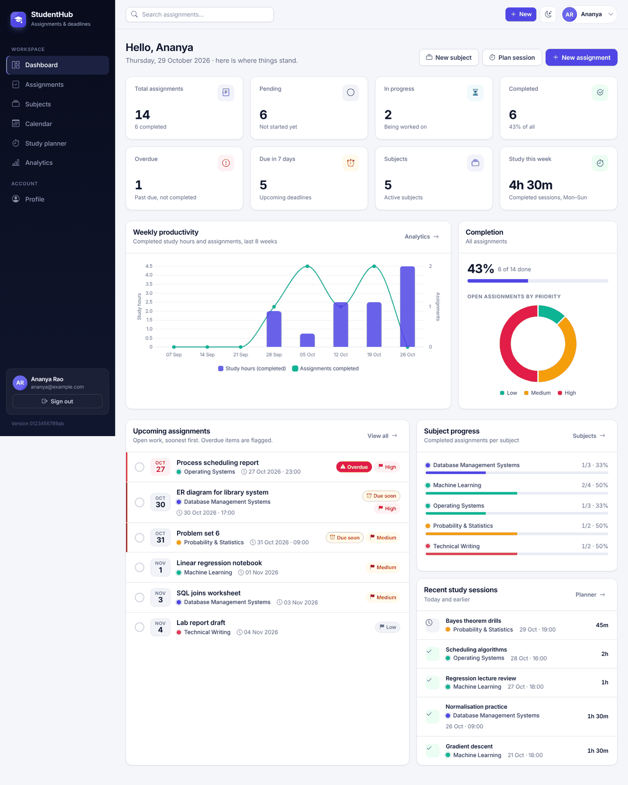
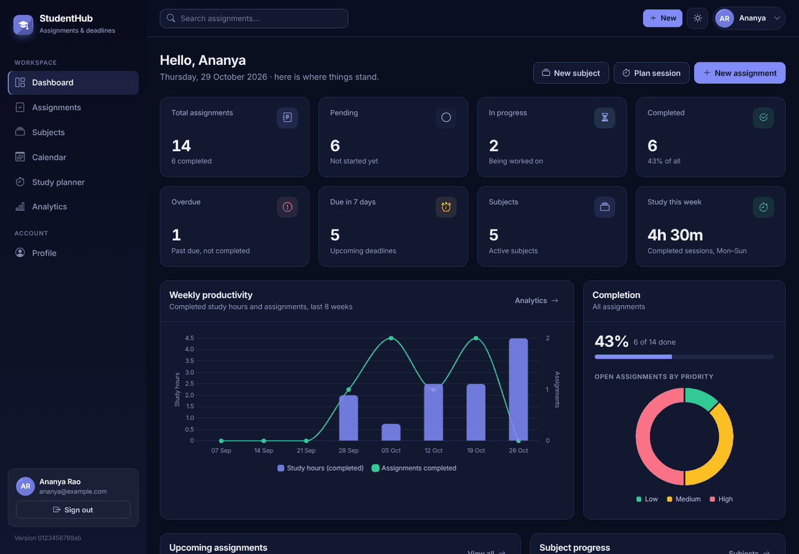
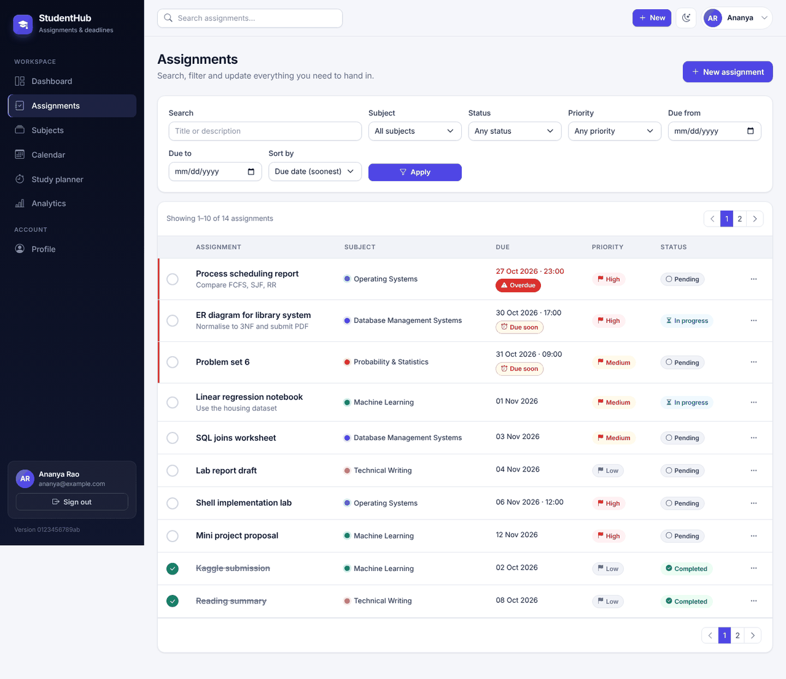
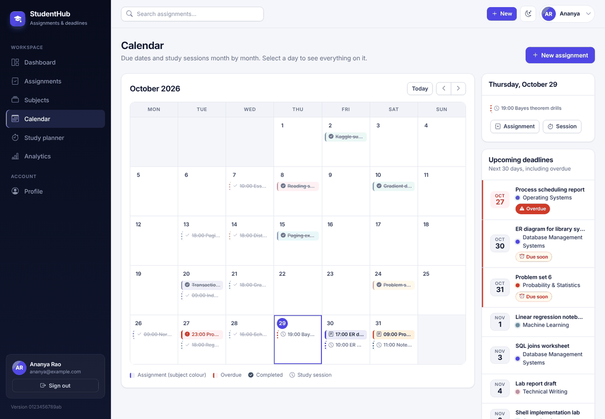
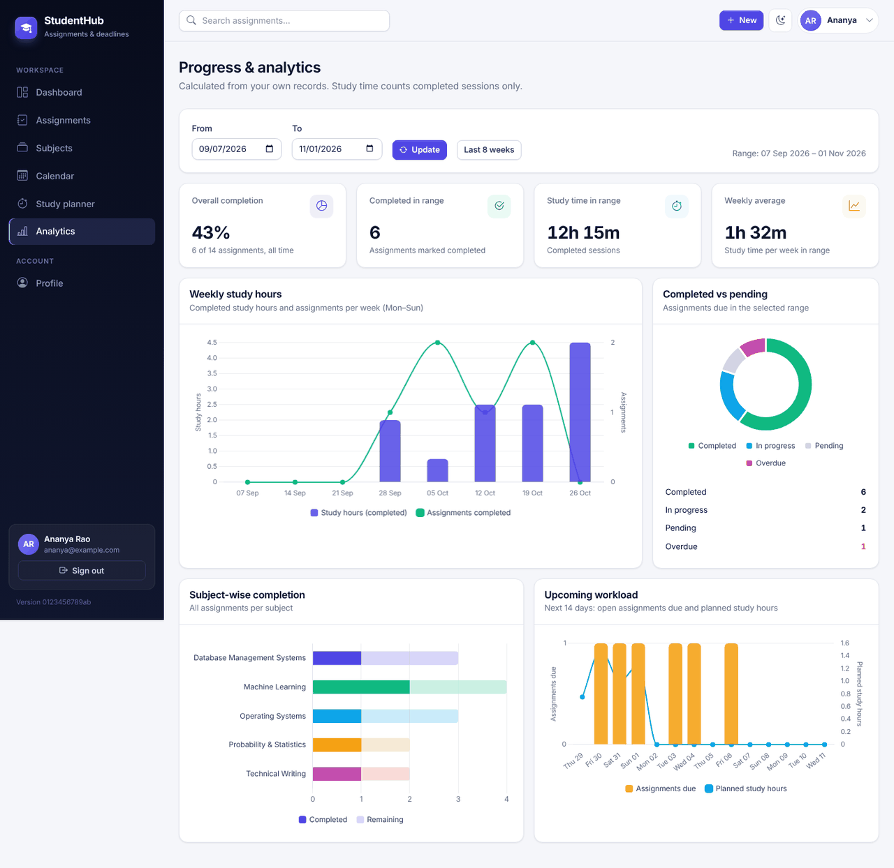
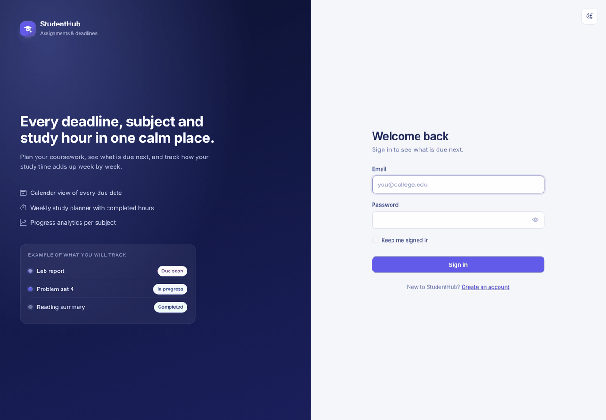
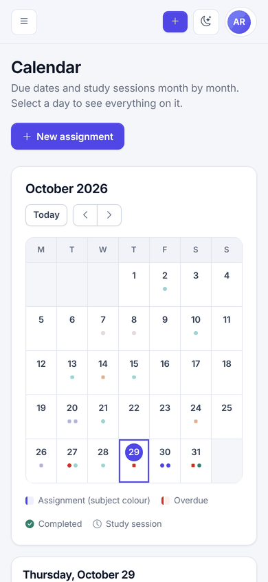
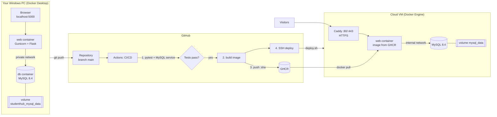
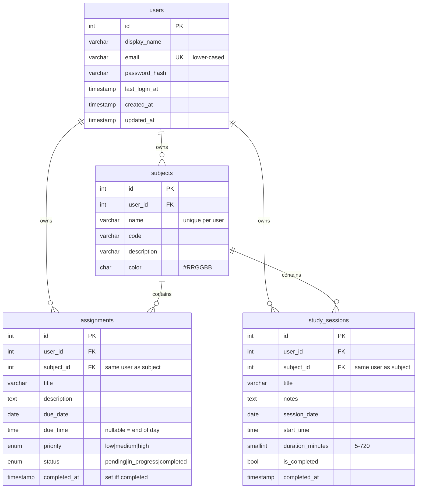

# StudentHub — Assignment and Deadline Tracker

StudentHub is a full-stack academic productivity web app. Students organise subjects,
track assignments and deadlines, plan study sessions and watch their progress on a
dashboard and analytics page. It is built with **HTML, CSS and vanilla JavaScript**, a
**Python Flask** backend and a **MySQL 8.4** database, packaged with **Docker**, tested with
**Pytest**, and shipped by a **GitHub Actions** pipeline that publishes images to **GHCR** and
deploys them to a Linux cloud server behind **Caddy** (automatic HTTPS).

> **How to read this manual.** Sections 7–19 are everything you need on your Windows PC.
> Sections 20–25 connect GitHub. Sections 26–32 set up the live server (one time).
> Sections 33–39 are reference material. Commands marked **one-time** are run once;
> commands marked **daily** are the ones you will use over and over.

---

## Contents

1. [Overview](#1-overview) · 2. [Features](#2-features) · 3. [Screenshots](#3-screenshots) · 4. [Technology stack](#4-technology-stack) · 5. [Architecture](#5-architecture) · 6. [Folder structure](#6-folder-structure)
7. [Windows prerequisites](#7-prerequisites-for-windows) · 8. [Install and verify tools](#8-install-and-verify-git-docker-desktop-and-python) · 9. [Clone](#9-clone-the-repository) · 10. [Configure .env](#10-configure-env) · 11. [Run locally](#11-run-locally-with-one-command) · 12. [Open the app](#12-open-the-application) · 13. [Using StudentHub](#13-register-and-use-studenthub)
14. [Containers](#14-check-the-docker-containers) · 15. [Logs](#15-view-application-and-database-logs) · 16. [Stop safely](#16-stop-the-application-safely) · 17. [Restart](#17-restart-the-application) · 18. [Rebuild](#18-rebuild-after-code-changes) · 19. [Tests](#19-run-the-tests)
20. [Git setup](#20-initialise-git-and-connect-github) · 21. [Existing repo / origin](#21-existing-github-repository-expense_tracker-and-an-existing-origin) · 22. [Initial push](#22-exact-initial-git-commands) · 23. [Daily push](#23-commands-for-future-commits-and-pushes) · 24. [GitHub Actions](#24-github-actions-setup-and-verification) · 25. [GHCR](#25-ghcr-package-setup)
26. [Cloud VM](#26-cloud-vm-provisioning) · 27. [SSH](#27-ssh-configuration) · 28. [GitHub Secrets](#28-github-secrets-and-variables) · 29. [Automated deployment](#29-automated-deployment-setup) · 30. [HTTPS and domains](#30-https-and-optional-domain) · 31. [Verify live](#31-verify-a-successful-live-deployment) · 32. [End-to-end update test](#32-test-an-automatic-update-end-to-end)
33. [Database schema](#33-database-schema-and-relationships) · 34. [Backup and restore](#34-database-backup-and-restore) · 35. [Migrations](#35-database-migrations) · 36. [Rollback](#36-deployment-rollback) · 37. [Troubleshooting](#37-troubleshooting) · 38. [Security](#38-security-notes) · 39. [Limitations](#39-known-limitations-and-future-improvements) · [Quick-start checklist](#quick-start-checklist)

---

## 1. Overview

StudentHub answers three questions a student asks every day: *What is due next? What is
overdue? Am I actually studying enough?* Every number in the app is computed on the server
from the signed-in user's own MySQL records; nothing is faked and no user can see another
user's data.

The project deliberately follows the classic Dockerised Flask + MySQL pattern: the app and
the database run as separate containers on a private Compose network, and the database
keeps its data in a named volume so containers can be rebuilt or replaced freely.

## 2. Features

| Area | What you can do |
|---|---|
| **Accounts** | Register, sign in/out, "keep me signed in", edit name and email, change password (signs out other devices). Passwords are hashed; sessions use secure cookies; all forms have CSRF protection. |
| **Dashboard** | Total / pending / in-progress / completed / overdue assignments, deadlines in the next 7 days, subject count, completed study time this week, completion %, upcoming list with one-click complete, recent sessions, weekly productivity chart, priority doughnut, per-subject progress, quick actions. |
| **Subjects** | Create, view, edit, delete; name, optional code, description, colour label; per-subject completion, overdue count and study time. |
| **Assignments** | Create, view, edit, delete; subject, due date + optional time, priority, status; mark completed / reopen / start; search (title + description); filter by subject, status (incl. *overdue* and *not completed*), priority and due-date range; sort; pagination; overdue and due-soon highlighting. |
| **Calendar** | Monthly grid with previous/next/today, assignment and study-session indicators in subject colours, completed and overdue styles, day panel with links and "add on this day", upcoming deadlines list. |
| **Study planner** | Schedule sessions (subject, title, notes, date, start time, duration), week-by-week view, mark done/undone, edit, delete, weekly planned vs. completed time, all-time total, "next up" list. |
| **Analytics** | Overall completion rate, completed-vs-pending for a date range, weekly study hours, subject-wise completion, 14-day upcoming workload, date-range filter, honest empty states. |
| **UX** | Light/dark theme (remembered, no flash on load), responsive sidebar → mobile menu, toasts, confirmation dialogs, loading buttons, keyboard-accessible controls, friendly 403/404/500/503 pages. |
| **Ops** | `/health` endpoint with DB check and running version, Docker health checks, structured logs, automatic migrations, backups before every deployment, automatic rollback if a new version is unhealthy. |

**Definitions used everywhere.** *Overdue* = not completed and the due moment (due date +
due time, or 23:59:59 if no time) is in the past. *Due soon* = not completed and due within
48 hours. *Upcoming* (dashboard) = not completed and due within 7 days. *Study time* counts
completed sessions only. Weeks run Monday–Sunday.

## 3. Screenshots

The images below were captured from this exact code running in production mode with sample
data. Replace them with screenshots of your own instance for your submission.

| Dashboard | Dark theme |
|---|---|
|  |  |
| **Assignments** | **Calendar** |
|  |  |
| **Analytics** | **Sign in** |
|  |  |



**To add your own:** open a page, press `Win + Shift + S` to capture, save the PNG into
`docs\screenshots\` using the same file name (or a new one and update the table above),
then commit it.

## 4. Technology stack

| Layer | Technology |
|---|---|
| Frontend | HTML5, CSS3 (custom design tokens), vanilla JavaScript, Bootstrap 5.3, Bootstrap Icons, Chart.js 4 — all served locally from `static/vendor` (no CDN, no Node.js) |
| Backend | Python 3.12, Flask 3.1, Flask-Login, Flask-WTF/WTForms (validation + CSRF), Werkzeug password hashing, Gunicorn |
| Database | MySQL 8.4 via `mysql-connector-python` (connection pool, parameterised queries) |
| Containers | Docker, Docker Compose (local), multi-stage `Dockerfile`, non-root runtime user |
| Testing | Pytest + Flask test client against a disposable MySQL database |
| CI/CD | GitHub Actions → GitHub Container Registry (GHCR) → SSH deployment |
| Hosting | Any Linux VM with Docker (Ubuntu 24.04 recommended) + Caddy reverse proxy with automatic HTTPS |

## 5. Architecture



**Request flow:** browser → (Caddy in production) → Gunicorn → Flask blueprint → `studenthub/db.py`
(pooled connection, parameterised SQL) → MySQL. Every query that touches user data filters by
`user_id`, and the database itself enforces that an assignment or study session can only
reference a subject owned by the same user (composite foreign key).

**Start-up:** the web container's entrypoint waits for MySQL (`manage.py wait-db`), applies
pending migrations (`manage.py migrate`) and then starts Gunicorn. If MySQL is briefly
unreachable later, the affected request shows a friendly 503 page and the next request
reconnects automatically.

## 6. Folder structure

```
StudentHub/
├── app.py                    Flask application factory, error pages, /health, security headers
├── config.py                 Settings from environment variables (development/production/testing)
├── wsgi.py                   Gunicorn entry point (wsgi:app)
├── manage.py                 wait-db, migrate, migration-status commands
├── gunicorn.conf.py          Gunicorn settings
├── requirements.txt          Runtime dependencies (pinned)
├── requirements-dev.txt      + pytest
├── Dockerfile                Multi-stage image: base → test → production
├── compose.yaml              Local stack (web + db) and the "test" profile (tests + db-test)
├── .env.example              Template for your local .env
├── .dockerignore  .gitignore  .gitattributes
├── pytest.ini
├── docker/
│   └── entrypoint.sh         wait for DB → migrate → start server
├── studenthub/               Application package
│   ├── db.py                 Connection pool, query helpers, transactions, health check
│   ├── migrations.py         Forward-only SQL migration runner with checksums and a lock
│   ├── auth.py               Register, login, logout, profile, password change
│   ├── subjects.py           Subject CRUD and per-subject statistics
│   ├── assignments.py        Assignment CRUD, status, search, filters, sorting, pagination
│   ├── study.py              Study planner
│   ├── main.py               Dashboard, calendar (+ JSON API), analytics
│   ├── stats.py              All dashboard/analytics calculations
│   ├── forms.py              Server-side validation (WTForms)
│   └── utils.py              Time zone helpers, overdue definition, shared helpers
├── database/
│   └── migrations/
│       ├── 001_initial_schema.sql
│       └── README.md         How to add migration 002, 003, ...
├── templates/                Jinja2 templates (base layout, pages, errors/error.html, macros)
├── static/
│   ├── css/style.css         Design system (light + dark tokens)
│   ├── js/                   theme-init.js, app.js, calendar.js, charts.js
│   ├── images/favicon.svg
│   └── vendor/               Bootstrap, Bootstrap Icons, Chart.js, Inter font (with licences)
├── tests/                    conftest.py + test_auth / dashboard / subjects / assignments / study_sessions / security
├── scripts/
│   ├── run-local.ps1         Start locally (creates .env with random secrets on first run)
│   ├── stop-local.ps1        Stop without deleting data
│   ├── run-tests.ps1         Run pytest in Docker with a throw-away DB
│   ├── backup-db.ps1         Local backup to .\backups
│   ├── restore-db.ps1        Local restore (asks for confirmation)
│   ├── publish.ps1           Test → commit → push (only when you run it)
│   ├── healthcheck.py        Health probe used by Docker, deploy.sh and CI
│   ├── deploy.sh             Server-side deployment with backup and automatic rollback
│   └── server-setup.sh       One-time VM preparation (Docker, user, firewall, .env)
├── deploy/
│   ├── compose.prod.yaml     Production stack: caddy + web + db
│   ├── Caddyfile             Reverse proxy and automatic HTTPS
│   └── .env.production.example
├── docs/screenshots/
└── .github/workflows/ci-cd.yml
```

---

## 7. Prerequisites for Windows

* Windows 10 (22H2) or Windows 11, 64-bit, with hardware virtualisation enabled in BIOS
  (Task Manager → Performance → CPU → "Virtualization: Enabled").
* **WSL 2** (Docker Desktop installs/uses it).
* **Docker Desktop**, **Git for Windows**, **VS Code** (recommended).
* **Python 3.12** is optional: the app and tests run inside Docker. Install it only if you want
  to generate secrets with Python or run tests without Docker.
* About 4 GB free RAM and 5 GB free disk.

## 8. Install and verify Git, Docker Desktop and Python

**One-time.** Run in PowerShell (as your normal user):

```powershell
winget install --id Git.Git -e
winget install --id Docker.DockerDesktop -e
winget install --id Microsoft.VisualStudioCode -e
winget install --id Python.Python.3.12 -e      # optional
```

If `winget` is unavailable, download the installers from git-scm.com, docker.com and python.org.
Restart Windows after installing Docker Desktop, open it once, accept the terms and wait until
the status bar shows **Engine running**.

Verify (open a **new** PowerShell window):

```powershell
git --version
docker version
docker compose version
python --version          # optional
```

`docker version` must show both a *Client* and a *Server* section. If *Server* is missing,
Docker Desktop is not running.

Configure Git once with your name and email:

```powershell
git config --global user.name "Your Name"
git config --global user.email "you@example.com"
git config --global init.defaultBranch main
```

## 9. Clone the repository

If the project is already on GitHub:

```powershell
cd $HOME\Documents
git clone https://github.com/<your-github-username>/studenthub-assignment-tracker.git StudentHub
cd StudentHub
code .
```

If you received the project as a zip, extract it to e.g. `C:\Users\<you>\Documents\StudentHub`,
then `cd` into that folder and continue. Section 22 shows how to put it on GitHub.

## 10. Configure .env

The app reads its settings from a `.env` file in the project folder. It is git-ignored and
must never be committed.

**Easiest (recommended):** skip this section. `.\scripts\run-local.ps1` (section 11) creates
`.env` automatically on the first run and fills in strong random secrets.

**Manual way (one-time):**

```powershell
Copy-Item .env.example .env
python -c "import secrets; print(secrets.token_urlsafe(48))"   # copy the output
code .env
```

In `.env` replace:

| Variable | Set it to |
|---|---|
| `SECRET_KEY` | the long random string you just generated |
| `MYSQL_PASSWORD` | any strong password (letters and digits) for the app's database user |
| `MYSQL_ROOT_PASSWORD` | a *different* strong password (used only for backups/admin) |

Everything else can stay as it is. All variables:

| Variable | Default | Purpose |
|---|---|---|
| `APP_ENV` | `development` | `development`, `production` or `testing` |
| `SECRET_KEY` | — | signs session cookies (production requires ≥ 32 characters) |
| `DB_HOST` / `DB_PORT` | `db` / `3306` | the Compose service name of MySQL |
| `MYSQL_DATABASE` / `MYSQL_USER` | `studenthub` | application database and its **non-root** user |
| `MYSQL_PASSWORD` / `MYSQL_ROOT_PASSWORD` | — | database passwords |
| `APP_PORT` | `5000` | port on your PC (`http://localhost:5000`) |
| `APP_TIMEZONE` | `Asia/Kolkata` | time zone for due dates, sessions and "today" |
| `LOG_LEVEL` | `INFO` | `DEBUG`, `INFO`, `WARNING` |
| `GUNICORN_WORKERS` | `2` | server worker processes |

> **Important:** MySQL stores the passwords the *first* time its volume is created. If you
> change `MYSQL_PASSWORD` later, see "Access denied" in section 37.

To set a variable only for the current PowerShell session (for example for a one-off
command), use `$env:LOG_LEVEL = "DEBUG"`. Values in `.env` are what Docker Compose uses.

## 11. Run locally with one command

**Daily.** From the project folder:

```powershell
docker compose up -d --build
```

That single command builds the app image, starts MySQL, waits until MySQL is healthy, applies
the database migrations automatically and starts the web server. You never run `app.py`,
create tables or start MySQL yourself.

Helper script (same thing, plus first-run `.env` creation and a health wait):

```powershell
powershell -ExecutionPolicy Bypass -File .\scripts\run-local.ps1 -Open
```

The first run downloads the Python and MySQL images and can take a few minutes.

## 12. Open the application

Open **http://localhost:5000** in your browser.

Check health from PowerShell:

```powershell
Invoke-RestMethod http://localhost:5000/health
```

Expected: `status : ok`, `database : ok`, `version : local`.

## 13. Register and use StudentHub

1. Click **Create an account**, enter your name, email and a password (8+ characters with a
   letter and a number). You are signed in straight away.
2. **Subjects → New subject.** Add each course (e.g. *Database Management Systems*, code *CS301*)
   and pick a colour.
3. **New → Assignment.** Choose the subject, due date (today or later), optional due time,
   priority and status. Leave the time empty to mean "end of day".
4. **Dashboard.** Tick the circle next to an assignment to complete it; tick again to reopen.
   Overdue work has a red marker; work due within 48 hours has an amber marker.
5. **Assignments.** Search, filter (subject, status incl. *Overdue*, priority, due range), sort
   and page through everything. The ⋯ menu offers view, edit, start and delete.
6. **Calendar.** Use ‹ › and **Today** to move between months; click a day to see its items
   and add an assignment or session on that date.
7. **Study planner.** Plan sessions, then click **Mark done** after studying. Only completed
   sessions count as study hours on the dashboard and analytics.
8. **Analytics.** Choose a date range to see weekly study hours, completed vs. pending work,
   per-subject completion and the next 14 days of workload.
9. **Theme.** The moon/sun button switches light/dark; your choice is remembered.
10. **Profile.** Change your name, email or password.

**Deleting a subject:** if it still has assignments or study sessions, you must tick
"I understand its assignments and sessions will be deleted" before deleting. The subject and
all of its records are then removed in one transaction. Nothing is ever left orphaned.

**Time zone:** dates and times you type (due dates, session times) are interpreted in
`APP_TIMEZONE`. Audit timestamps (created/updated/completed) are stored in UTC and shown in
`APP_TIMEZONE`.

## 14. Check the Docker containers

```powershell
docker compose ps
```

Both `studenthub-db-1` and `studenthub-web-1` should show `Up ... (healthy)`. Details:

```powershell
docker inspect --format "{{.State.Health.Status}}" studenthub-web-1
docker volume ls          # studenthub_mysql_data holds your data
```

## 15. View application and database logs

```powershell
docker compose logs --tail=50        # last 50 lines of every service
docker compose logs -f web           # follow the app (Ctrl+C to stop following)
docker compose logs -f db            # follow MySQL
docker compose exec web python manage.py migration-status
```

## 16. Stop the application safely

**Daily.**

```powershell
docker compose down
```

or `powershell -ExecutionPolicy Bypass -File .\scripts\stop-local.ps1`.

`down` removes containers but **keeps** the `studenthub_mysql_data` volume, so your data is
there next time.

> ⚠️ **Never use `docker compose down -v` for routine cleanup.** The `-v` flag deletes the
> database volume and permanently erases every account, subject, assignment and session.
> Use it only if you deliberately want an empty database, after taking a backup (section 34).

## 17. Restart the application

```powershell
docker compose restart web        # restart only the app
docker compose up -d              # start everything again after "down" (no rebuild)
```

## 18. Rebuild after code changes

Templates, CSS, JavaScript and Python are baked into the image, so after editing code:

```powershell
docker compose up -d --build
```

Only the `web` container is rebuilt and replaced; MySQL and its data are untouched.
**Rebuilding an image ≠ recreating the database.** Code changes need a rebuild; schema changes
additionally need a migration file (section 35), which is applied automatically on start.

## 19. Run the tests

**Daily** (before pushing):

```powershell
powershell -ExecutionPolicy Bypass -File .\scripts\run-tests.ps1
```

This is equivalent to:

```powershell
docker compose --profile test run --rm --build tests
docker compose --profile test rm --stop --force db-test
```

The tests use a separate MySQL container (`db-test`) whose data lives only in memory, and the
test configuration refuses to run against any database whose name does not end in `_test`,
so your development data can never be touched. Run a subset with
`.\scripts\run-tests.ps1 -PytestArgs "-k assignments -v"`.

*Without Docker (optional):* with Python 3.12 and a reachable MySQL test database,
`pip install -r requirements-dev.txt` then set `DB_HOST`, `MYSQL_DATABASE=studenthub_test`,
`MYSQL_USER`, `MYSQL_PASSWORD` and run `python -m pytest`.

The suite (61 tests) covers registration, login/logout, protected routes, profile and password
changes, subject/assignment/session CRUD, status transitions, due-date validation, search,
filters, sorting, pagination, dashboard totals, chart data, calendar API, analytics, user
isolation (reading, editing and deleting other users' records), CSRF, security headers,
health checks, database outages and migration safety.

---

## 20. Initialise Git and connect GitHub

Decide where the code will live on GitHub (section 21), then use section 22. Useful checks at
any time:

```powershell
git status            # what changed; .env must NOT appear here
git remote -v         # where "origin" points
git branch            # current branch (should be * main)
git log --oneline     # recent commits
```

## 21. Existing GitHub repository (expense_tracker) and an existing origin

Your GitHub account already has a repository called `expense_tracker`. Pick **one** option.

**Option A — create a new repository (recommended, cleanest).**
On GitHub: **+ → New repository**, name `studenthub-assignment-tracker`, *Public* or
*Private*, **do not** add a README, .gitignore or licence. Then follow section 22.

**Option B — rename `expense_tracker` and reuse it.**
1. On GitHub open `expense_tracker` → **Settings → General → Repository name** →
   `studenthub-assignment-tracker` → **Rename**. (Old URLs keep redirecting.)
2. The renamed repository still contains the old expense tracker code. Replace it without
   rewriting history:

   ```powershell
   cd $HOME\Documents
   git clone https://github.com/<your-github-username>/studenthub-assignment-tracker.git studenthub-repo
   cd studenthub-repo
   git switch main                                  # if the old default was "master": git branch -m master main
   # remove the old files (keeps the .git history folder)
   Get-ChildItem -Force | Where-Object { $_.Name -ne ".git" } | Remove-Item -Recurse -Force
   # copy StudentHub in, including dot-files, but never .git or your .env
   Get-ChildItem -Force ..\StudentHub | Where-Object { $_.Name -notin @(".git", ".env") } |
     Copy-Item -Destination . -Recurse -Force
   git add -A
   git status                                       # check .env is not listed
   git commit -m "Replace expense tracker with StudentHub"
   git push origin main
   ```

   If the old default branch was `master`, also set **Settings → Branches → Default branch** to
   `main` after pushing.

**If `origin` already exists** in your local folder (for example it still points at
`expense_tracker`):

```powershell
git remote -v
git remote set-url origin https://github.com/<your-github-username>/studenthub-assignment-tracker.git
git remote -v        # verify
```

## 22. Exact initial Git commands

From the StudentHub folder (Option A). The first command checks whether the folder is already
a Git repository so that `git init` is never repeated:

```powershell
if (-not (Test-Path .git)) { git init -b main } else { "Already a Git repository" }
git branch -M main
git add .
git status            # confirm .env, backups/ and __pycache__/ are NOT listed
git commit -m "Initial StudentHub project"
git remote add origin https://github.com/<your-github-username>/studenthub-assignment-tracker.git
git push -u origin main
```

If `git remote add` says *remote origin already exists*, run the `git remote set-url` command
from section 21 instead. When Git asks you to sign in, use the browser window that opens
(Git Credential Manager); never paste your GitHub password into scripts.

The first push already starts the pipeline (tests + image). Deployment stays off until you
complete sections 26–29.

## 23. Commands for future commits and pushes

**Daily:**

```powershell
.\scripts\run-tests.ps1               # optional but recommended
git add .
git commit -m "Describe the change"
git push origin main
```

Or in one step, which refuses to push if any test fails:

```powershell
powershell -ExecutionPolicy Bypass -File .\scripts\publish.ps1 -Message "Describe the change"
```

If `git push` is rejected because GitHub has newer commits: `git pull --rebase origin main`,
then push again. For bigger changes, work on a branch and open a pull request — the pipeline
tests and builds pull requests but never deploys them:

```powershell
git switch -c feature/calendar-colours
git push -u origin feature/calendar-colours     # then open a Pull Request on GitHub
```

## 24. GitHub Actions setup and verification

Nothing to install: the workflow is in `.github/workflows/ci-cd.yml` and runs automatically.

| Trigger | Jobs |
|---|---|
| Pull request → `main` | **Test** → **Build image** (not published) |
| Push to `main` | **Test** → **Build image and publish to GHCR** → **Deploy to cloud server** (once enabled) |
| Manual (*Run workflow*) | same as push; optional `rollback_tag` redeploys an earlier image |

Verify: GitHub → your repository → **Actions** → workflow **CI/CD** → latest run. Each job
shows a green tick or a red cross; click a job to read its log. A failing test stops the run
before anything is built or deployed. Tests run against a disposable `mysql:8.4` service
container, so CI never needs production credentials.

The workflow uses least-privilege permissions (`contents: read` by default, `packages: write`
only in the build job), pins every third-party action to an exact commit SHA, and allows only
one production deployment at a time.

## 25. GHCR package setup

After the first successful push to `main`, the image appears under your GitHub profile →
**Packages** → `studenthub-assignment-tracker`, as
`ghcr.io/<your-github-username-in-lowercase>/studenthub-assignment-tracker`.

Tags published for every commit on `main`:

* `:<full commit SHA>` — immutable, used for deployment and rollback
* `:main` and `:latest` — moving convenience tags pointing at the newest build

Authentication uses the workflow's built-in `GITHUB_TOKEN`; no password or personal token is
stored in the repository.

**Visibility.** Check it on the package page → **Package settings → Danger Zone → Change
visibility**.
* *Private* works with automatic deployment: the deploy job passes its short-lived token to the
  server for that one pull and logs out afterwards.
* *Public* also lets you pull images by hand on the server without logging in (handy for manual
  rollbacks). The image contains no secrets, so public is fine for a college project.
* For manual pulls of a *private* image, create a classic personal access token with **only**
  the `read:packages` scope and on the server run
  `docker login ghcr.io -u <your-github-username>` (paste the token when asked).

If the package is not linked to the repository (rare), open **Package settings → Manage Actions
access** and add the repository with *Write* access.

---

## 26. Cloud VM provisioning

**One-time, manual.** Creating a server requires an account with a cloud provider (and often a
payment method or student verification); this cannot be automated from the repository.
Any provider that gives you an Ubuntu VM with a public IP works, for example AWS EC2,
Microsoft Azure (Azure for Students), Google Cloud, DigitalOcean (often available through the
GitHub Student Developer Pack) or Oracle Cloud. Check each provider's current free-tier or
credit terms before you create anything.

Choose:

* **Image:** Ubuntu Server 24.04 LTS (22.04 also works)
* **Size:** 1 vCPU / 1 GB RAM minimum (2 GB recommended); 20 GB disk
* **Authentication:** SSH key (create one in section 27 first) — the provider usually creates
  an admin user such as `ubuntu` or `azureuser`
* **Network / security group / cloud firewall:** allow inbound **TCP 22, 80, 443** (and UDP 443
  for HTTP/3). Do **not** open 3306.
* Prefer a **static/reserved public IP** so the address does not change after a reboot.

Write down the public IP, e.g. `203.0.113.10`.

## 27. SSH configuration

Windows 10/11 include OpenSSH. Create **two** key pairs in PowerShell — one for you, one used
only by GitHub Actions:

```powershell
ssh-keygen -t ed25519 -C "my-laptop" -f $HOME\.ssh\id_ed25519
ssh-keygen -t ed25519 -C "github-actions-deploy" -f $HOME\.ssh\studenthub_deploy
```

Press **Enter** at the passphrase prompts for the deploy key (GitHub Actions cannot type a
passphrase); you may set one for your personal key. Upload the content of
`$HOME\.ssh\id_ed25519.pub` as the VM's SSH key when creating it (section 26).

Connect and accept the host fingerprint:

```powershell
ssh ubuntu@203.0.113.10
```

**Prepare the server (one-time).** Copy the setup script to the server and run it:

```powershell
scp .\scripts\server-setup.sh ubuntu@203.0.113.10:~/
Get-Content $HOME\.ssh\studenthub_deploy.pub      # copy this whole line
ssh ubuntu@203.0.113.10
```

On the server (replace the three values; use your IP with dashes for `--site`, see section 30):

```bash
sudo bash server-setup.sh \
  --image ghcr.io/<your-github-username-lowercase>/studenthub-assignment-tracker \
  --site 203-0-113-10.sslip.io \
  --pubkey "ssh-ed25519 AAAA... github-actions-deploy"
exit
```

The script installs Docker Engine and the Compose plugin from Docker's official repository,
creates a `deploy` user allowed to run Docker, authorises the deploy key, enables the UFW
firewall (22/80/443 only), adds swap on small VMs and writes `/home/deploy/studenthub/.env`
with random secrets. It is safe to re-run.

Test the deploy key from Windows:

```powershell
ssh -i $HOME\.ssh\studenthub_deploy deploy@203.0.113.10 "docker version --format '{{.Server.Version}}'"
```

Collect the server's host key for GitHub (protects the deployment against impersonation):

```powershell
ssh-keyscan -t ed25519 203.0.113.10
ssh-keyscan -t ed25519 203.0.113.10 | ssh-keygen -lf -     # compare with the fingerprint you accepted above
```

## 28. GitHub Secrets and variables

GitHub → repository → **Settings → Secrets and variables → Actions**.

**Secrets** tab → *New repository secret*:

| Name | Value |
|---|---|
| `DEPLOY_HOST` | server public IP or hostname, e.g. `203.0.113.10` |
| `DEPLOY_USER` | `deploy` |
| `DEPLOY_SSH_KEY` | the **private** key: output of `Get-Content $HOME\.ssh\studenthub_deploy -Raw` (including the BEGIN/END lines) |
| `DEPLOY_KNOWN_HOSTS` | the output line of `ssh-keyscan -t ed25519 203.0.113.10` |

**Variables** tab → *New repository variable*:

| Name | Value |
|---|---|
| `DEPLOY_ENABLED` | `true` (turns the deploy job on) |
| `PUBLIC_URL` | `https://203-0-113-10.sslip.io` (or your domain; `http://203.0.113.10` if `SITE_ADDRESS=:80`) |
| `DEPLOY_PORT` | optional, only if SSH is not on port 22 |

Secrets are masked in logs and are not available to pull requests from forks. The private key
never leaves GitHub's encrypted storage and is deleted from the runner at the end of the job.

## 29. Automated deployment setup

With sections 26–28 done, trigger a deployment: GitHub → **Actions → CI/CD → Run workflow**
(branch `main`, leave *rollback_tag* empty), or push any commit to `main`.

The **Deploy to cloud server** job then:

1. copies `deploy/compose.prod.yaml`, `deploy/Caddyfile` and `scripts/deploy.sh` to
   `~/studenthub` on the server;
2. runs `deploy.sh <commit SHA>`, which pulls `ghcr.io/…:<sha>`, backs up the database to
   `~/studenthub/backups`, replaces only the web container (`docker compose up -d`), waits for
   its health check and confirms `/health` reports exactly that version;
3. if the new version is unhealthy, switches back to the previous version automatically and
   marks the job failed;
4. finally checks `PUBLIC_URL/health` from the internet.

The production stack (`deploy/compose.prod.yaml`) runs Caddy (ports 80/443), the app and MySQL.
MySQL is on an internal network with no published port, its data lives in the `mysql_data`
volume, and no step ever runs `docker compose down -v` or deletes volumes. Production settings
live only in `~/studenthub/.env` on the server (`deploy/.env.production.example` documents them).

Useful commands on the server (`ssh deploy@203.0.113.10`, then `cd ~/studenthub`):

```bash
./deploy.sh status                                     # current/previous version + containers
docker compose -f compose.prod.yaml ps
docker compose -f compose.prod.yaml logs --tail=100 web
docker compose -f compose.prod.yaml logs -f caddy
docker compose -f compose.prod.yaml restart web
```

## 30. HTTPS and optional domain

Caddy obtains and renews a free Let's Encrypt certificate automatically for the address in
`SITE_ADDRESS` (in `~/studenthub/.env` on the server). Ports 80 and 443 must be reachable.

* **No domain:** `SITE_ADDRESS=203-0-113-10.sslip.io` — the free sslip.io service resolves that
  name to `203.0.113.10`, so you get real HTTPS without buying a domain.
* **First smoke test without HTTPS:** `SITE_ADDRESS=:80` serves plain HTTP on the IP. Session
  cookies are marked *Secure* in production, so sign-in only works over HTTPS — use this only
  to see that the site responds, then switch to a hostname.
* **Your own domain later:** create a DNS **A record** (e.g. `studenthub.example.com` → your
  server IP), wait until `nslookup studenthub.example.com` returns the IP, then on the server:

  ```bash
  cd ~/studenthub
  sed -i 's/^SITE_ADDRESS=.*/SITE_ADDRESS=studenthub.example.com/' .env
  docker compose -f compose.prod.yaml up -d caddy
  ```

  Update the `PUBLIC_URL` variable on GitHub to `https://studenthub.example.com`.

## 31. Verify a successful live deployment

1. GitHub → **Actions**: the latest **CI/CD** run shows three green jobs; the summary says
   *Deployed `<sha>` successfully*.
2. From your PC:

   ```powershell
   Invoke-RestMethod https://203-0-113-10.sslip.io/health
   git rev-parse HEAD        # must equal the "version" field above
   ```

3. Open the site, register an account and create a subject.
4. On the server: `./deploy.sh status` shows the same SHA as *current*.

## 32. Test an automatic update end to end

1. Change something visible, e.g. in `templates/dashboard.html` change
   `here is where things stand.` to `here is your study overview.`
2. `docker compose up -d --build` and check http://localhost:5000.
3. `.\scripts\run-tests.ps1` (a test that fails will stop the pipeline).
4. `git add .` → `git commit -m "Update dashboard greeting"` → `git push origin main`.
5. Watch **Actions**. When **Deploy to cloud server** is green, reload the live site: the new
   text appears and the account you created earlier still exists (data persisted).
6. `Invoke-RestMethod <PUBLIC_URL>/health` shows the new commit SHA.

Changes are **not** visible on the live site until the deploy job finishes successfully. A
failed test, build or health check never replaces the running version.

---

## 33. Database schema and relationships



* `(subject_id, user_id)` in `assignments` and `study_sessions` references
  `subjects(id, user_id)`, so the **database** rejects linking a record to another user's subject.
* `ON DELETE CASCADE` from users and subjects means deletes never leave orphans; the app also
  asks for explicit confirmation before deleting a subject that still has records.
* `CHECK` constraints enforce valid colours, durations and the completed/`completed_at` pairing.
* Indexes cover the common filters: `(user_id, due_date)`, `(user_id, status)`,
  `(user_id, priority)`, `(user_id, completed_at)`, `(user_id, session_date)` and subject lookups.
* `schema_migrations` records applied migrations (version, name, checksum, time).

## 34. Database backup and restore

**Local (PowerShell):**

```powershell
.\scripts\backup-db.ps1                                    # -> backups\studenthub-YYYYMMDD-HHMMSS.sql
.\scripts\restore-db.ps1 -File .\backups\studenthub-20261029-210000.sql   # asks you to type RESTORE
```

**Production:** `deploy.sh` writes `~/studenthub/backups/studenthub-<UTC time>.sql.gz` before every
deployment and keeps the newest 10. Make one any time and download it:

```bash
cd ~/studenthub && ./deploy.sh backup
```

```powershell
scp deploy@203.0.113.10:studenthub/backups/<file>.sql.gz .\backups\
```

Restore on the server (replaces current data — take a fresh backup first):

```bash
cd ~/studenthub
./deploy.sh backup
gunzip -c backups/<file>.sql.gz | docker compose -f compose.prod.yaml exec -T db \
  sh -c 'MYSQL_PWD="$MYSQL_ROOT_PASSWORD" mysql -uroot "$MYSQL_DATABASE"'
docker compose -f compose.prod.yaml restart web
```

Backups on the same server do not protect against losing the server; download important
backups to your PC or cloud storage regularly.

## 35. Database migrations

* Schema files live in `database/migrations/NNN_description.sql` (`001_initial_schema.sql` today).
* The web container applies pending files automatically on every start (`manage.py migrate`),
  in order, once each, under a MySQL lock, recording a checksum in `schema_migrations`.
* Running it repeatedly is safe; nothing is dropped or reset.
* To change the schema, **add** `002_…sql` (never edit an applied file — the runner refuses to
  start if an applied file's checksum changes). Keep changes additive so the previous release
  still works, which keeps rollback safe. Full procedure: `database/migrations/README.md`.
* Check state: `docker compose exec web python manage.py migration-status`
  (production: `docker compose -f compose.prod.yaml exec web python manage.py migration-status`).
* The runner never downgrades the schema; after a rollback to older code it logs which newer
  migrations it does not know and leaves them in place.

## 36. Deployment rollback

Every image is tagged with its commit SHA, so any earlier version can be redeployed.

* **Automatic:** if a new version fails its health check, `deploy.sh` restarts the previous
  version immediately and the workflow is marked failed.
* **From GitHub:** **Actions → CI/CD → Run workflow**, enter the full SHA of a good commit
  (from `git log` or the Actions history) in **rollback_tag**, run. Tests/build are skipped and
  that image is deployed and verified.
* **On the server:**

  ```bash
  cd ~/studenthub
  ./deploy.sh status
  ./deploy.sh rollback                # back to the previous successful version
  ./deploy.sh <full-commit-sha>       # or any specific version
  ```

  (For private packages pulled by hand, `docker login ghcr.io` first — section 25.)

Rolling back changes the application only. The database is left as is; restore a backup
(section 34) only if a release damaged data.

## 37. Troubleshooting

| Symptom | Fix |
|---|---|
| `docker` not recognised / *Cannot connect to the Docker daemon* / no *Server* in `docker version` | Start Docker Desktop and wait for *Engine running*. Enable WSL 2 / virtualisation if Docker Desktop asks. |
| `Bind for 0.0.0.0:5000 failed: port is already allocated` | Another program uses 5000. Set `APP_PORT=5050` in `.env`, run `docker compose up -d`, open http://localhost:5050. |
| `required variable SECRET_KEY is missing` / `Set MYSQL_PASSWORD in .env` | `.env` is missing or incomplete — section 10 (or run `run-local.ps1`). |
| Web container restarts; logs show **Access denied for user 'studenthub'** | You changed `MYSQL_PASSWORD` after the volume was first created (MySQL keeps the original). Put the old value back, **or** change it inside MySQL without losing data: run `docker compose exec db sh`, then inside the container `MYSQL_PWD=$MYSQL_ROOT_PASSWORD mysql -uroot -e "ALTER USER 'studenthub'@'%' IDENTIFIED BY 'NEW_PASSWORD_FROM_ENV';"` and `exit`, then `docker compose restart web`. Last resort, deletes all data: back up, then `docker compose down -v`. |
| `exec ... entrypoint: no such file or directory` or `/bin/sh^M` | Windows line endings. The image strips them, but also run `git config --global core.autocrlf input`, re-clone, rebuild. `.gitattributes` keeps `.sh` files LF. |
| Page says **Temporarily unavailable** (503) | MySQL is not reachable: `docker compose ps`, `docker compose logs db`. It recovers automatically once MySQL is back. |
| **Form expired** (400) | The page was open across a restart or sign-out. Reload and submit again. |
| Changes not visible locally | You did not rebuild: `docker compose up -d --build`. Hard-refresh the browser (`Ctrl+F5`). |
| Tests print *Refusing to run tests: MYSQL_DATABASE must end with '_test'* | Intended safety guard. Use `run-tests.ps1`, or set `MYSQL_DATABASE=studenthub_test`. |
| `Migration ... was modified after being applied` | Restore the original migration file and put your change in a new `00N_*.sql`. |
| Actions: `denied: installation not allowed to Create organization package` / `permission_denied` on push to GHCR | Package settings → Manage Actions access → give this repository *Write*. Make sure *Settings → Actions → General → Workflow permissions* is not restricted below what the workflow requests. |
| Deploy job: `Missing secrets/variables` | Add the listed items — section 28. |
| Deploy job: `Host key verification failed` | `DEPLOY_KNOWN_HOSTS` is missing/outdated (e.g. VM rebuilt). Re-run `ssh-keyscan` and update the secret. |
| Deploy job: `Permission denied (publickey)` | `DEPLOY_SSH_KEY` must be the private key including BEGIN/END lines, and its `.pub` must be in `/home/deploy/.ssh/authorized_keys`. |
| Deploy job: `could not pull ...` | The image tag does not exist (rollback to a SHA that was never built) or the package is private and not linked to the repository (section 25). |
| Public health check fails but server step passed | Cloud firewall/security group blocks 80/443, DNS not pointing to the server yet, or `PUBLIC_URL` does not match `SITE_ADDRESS`. Check `docker compose -f compose.prod.yaml logs caddy`. |
| Caddy logs *rate limited* / certificate errors | Let's Encrypt limits retries. Fix DNS/firewall first, wait an hour, then `docker compose -f compose.prod.yaml restart caddy`. |
| Sign-in works locally but not on `http://IP` | Production cookies are HTTPS-only. Use an HTTPS hostname (section 30). |

## 38. Security notes

* Passwords: Werkzeug salted hashes (scrypt); plaintext is never stored or logged.
* Sessions: HttpOnly, SameSite=Lax cookies; `Secure` in production; a new session on sign-in
  (prevents fixation); password change invalidates other sessions.
* CSRF tokens on every form; state-changing actions are POST-only.
* Authorisation: every query on user data filters by `user_id`; other users' records return
  404 (no information leak); the composite foreign key enforces ownership in MySQL too.
* SQL: parameterised queries everywhere; sort options and filters are whitelisted; `LIKE`
  wildcards in search terms are escaped.
* Headers: Content-Security-Policy (`script-src 'self'`, no inline scripts), X-Frame-Options,
  nosniff, Referrer-Policy, HSTS via Caddy. All frontend libraries are served locally.
* Errors: users see friendly pages; stack traces go only to server logs; `/health` reveals no
  configuration or credentials. Open-redirects via `next=` are blocked.
* Secrets: `.env` is git-ignored and excluded from the image; production refuses weak or
  missing `SECRET_KEY`/`MYSQL_PASSWORD`; CI uses `GITHUB_TOKEN` and encrypted secrets only.
* Infrastructure: app runs as a non-root user; MySQL has no published port and sits on an
  internal network; the app uses a dedicated non-root MySQL account; UFW allows only 22/80/443.
  (Docker-published ports bypass UFW, which is why only Caddy publishes any.)
* Recommended extras for a real deployment: disable SSH password login
  (`PasswordAuthentication no`), enable unattended security upgrades, and copy backups off the
  server.

## 39. Known limitations and future improvements

* No "forgot password" email flow and no login rate limiting yet (good next steps:
  Flask-Limiter, email via SMTP).
* Google/OAuth sign-in is not included; `auth.py` keeps login isolated so it can be added later.
* One application-wide time zone (`APP_TIMEZONE`) rather than per-user time zones.
* Single-server deployment: MySQL runs on the same VM as the app. A managed database and
  off-site backups would improve resilience.
* No file attachments, reminders/notifications, recurring assignments or shared/group work.
* Charts are rendered client-side with Chart.js; printing/exporting reports is not provided.

---

## Quick-start checklist

1. **One-time setup (PC):** install Git + Docker Desktop (section 8), open the project folder,
   `Copy-Item .env.example .env` and set `SECRET_KEY`, `MYSQL_PASSWORD`, `MYSQL_ROOT_PASSWORD`
   — or simply run `.\scripts\run-local.ps1`, which does it for you.
2. **Start locally (primary command):** `docker compose up -d --build`
3. **Test:** `powershell -ExecutionPolicy Bypass -File .\scripts\run-tests.ps1`
4. **Initial GitHub push:**
   ```powershell
   if (-not (Test-Path .git)) { git init -b main }
   git add . ; git commit -m "Initial StudentHub project"
   git remote add origin https://github.com/<your-github-username>/studenthub-assignment-tracker.git
   git push -u origin main
   ```
5. **One-time cloud + GitHub configuration:** create an Ubuntu VM with ports 22/80/443 open,
   run `scripts/server-setup.sh` on it (section 27), then add secrets `DEPLOY_HOST`,
   `DEPLOY_USER`, `DEPLOY_SSH_KEY`, `DEPLOY_KNOWN_HOSTS` and variables `DEPLOY_ENABLED=true`,
   `PUBLIC_URL` (section 28).
6. **Publish future changes:** `git add .` → `git commit -m "Describe the change"` →
   `git push origin main` (or `.\scripts\publish.ps1 -Message "..."`).
7. **Local URL:** http://localhost:5000
8. **Verify automatic deployment:** GitHub → Actions → CI/CD shows Test, Build, Deploy all green;
   `Invoke-RestMethod <PUBLIC_URL>/health` returns `status: ok` and `version` equal to
   `git rev-parse HEAD`.
